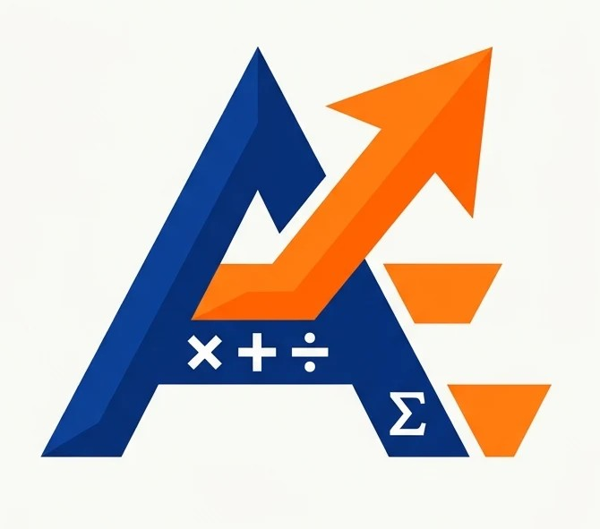

  

  <h1>Arithmo-Edge</h1>
  
<strong>Powered by Olympiad Edge</strong>

  
<em>The World's First Real-Time ELO-Rated Competitive Mathematics &amp; Olympiad Mega-Ecosystem.</em>

  

    
    
    
    
  

   

  

 

## Executive Overview &amp; Genesis Legacy

Competitive programming has thrived for decades on real-time ELO rating systems, live global rounds, and post-match peer hacking through platforms like Codeforces. Meanwhile, competitive mathematics remains trapped between static, 1990s-era asynchronous forums (such as AoPS) and gatekept, $300–$500+ preparatory courses.

**Arithmo-Edge** (*Powered by Olympiad Edge*) eliminates that asymmetry. Tracing its origin to the **`Prime-Factor.app`** foundational Genesis Pre-Era prototype (lightweight client-side BigInt primality and modular drills), **Arithmo-Edge** (`github.com/Arithmo-Edge`) expands into a full-scale 14-portal federated Olympiad infrastructure. The ecosystem launches initially on **Free Forever GitHub Pages** (`arithmo-edge.github.io/...`) and transitions to our dedicated **`.com` custom domain** **2 months post-launch** while keeping all GitHub Pages endpoints permanently synchronized.

**Zero GitHub Actions Cron Dependency:** All real-time edge routing, webhooks, deterministic `SymPy` proof verification, `5×4` Golden Vault reads, and 24-hour `Zero-PII` data lake pipelines execute exclusively via **Cloudflare Pages/Workers + Unified Firebase (`Auth + Firestore`)**—with zero brittle GitHub Actions cron bottlenecks.

---

## Federated 14-Portal System Architecture

Rather than scaling a brittle monolith, Arithmo-Edge operates as **14 independent yet unified portals** (`0. Core Portal` + `Subsites #1–#13`) orchestrated by our zero-dependency kernel (**`Arithmo-Core-SDK / engine.js`**). This federated spine enforces global Google OAuth SSO, `@handle` identity routing, 7-day 1-time free rename windows (`$2.99` once/year thereafter; permanent `@handle` tombstone upon deletion), Read-Shield edge caching, and Zero-PII data lake pipelines.

flowchart TB
    subgraph SDK["Centralized Federated Spine: Arithmo-Core-SDK (engine.js)"]
        AUTH["Firebase Gmail SSO &amp; @handle Tombstone Registry"]
        EDGE["Cloudflare Workers (Zero GitHub Actions) + Read-Shield Cache"]
    end

    CORE["0. Core Portal\narithmo-edge.github.io/Arithmo-Edge/"]

    subgraph ARENAS["5 Core Arenas: 1v1 Duels &amp; 12-Persona Shadow Bot Gauntlet Live Here"]
        NT["1. Number Theory\n(#00F0FF Cyan)"]
        ALG["2. Algebra\n(#8B5CF6 Violet)"]
        GEO["3. Geometry + GeoGebra\n(#F59E0B Amber)"]
        COMB["4. Combinatorics\n(#10B981 Emerald)"]
        MIX["5. Mixed Olympiad\n(#F43F5E Rose)"]
    end

    subgraph CONTESTS["Live &amp; Upcoming Contests Only + Security"]
        CONT["6. Contest Portal\n(7-Day Calendar, BdMO Warm-Ups &amp; Find the Flaw)"]
        QPRT["QPRT-4 Security Layer\n(App/Tab Lockdown, ChronoVault &amp; Optional Module 7)"]
        STAND["7. Standings Portal\n(14 Real-Time Leaderboards)"]
    end

    subgraph AI_INST["AI Engines, Academies, Forge, Governance &amp; Archive"]
        AI["8. Arithmo Personal AI\n(Dual-Model Selector + TokenMeter)"]
        ACAD["9. Academy Arena\n(4 Tiers, Guild AI, KYB &amp; Task Tab)"]
        FORGE["10. Arithmo Forge\n(1500+ ELO &amp; SymPy Verification)"]
        SOC["11. Socials &amp; 12. Headquarters Core"]
        DB["13. Arithmo Database (14th Portal)\n(Past Contests + IMO/Putnam/RMM/BMO/BdMO + AI Editorials)"]
    end

    LAKE["Zero-PII Cold JSONL Lake &amp; Zero-Copy Mathematical Genome\n(Cloudflare Workers 24h Pipeline · Never Leaks Unplayed &lt;3 Quorum Sets)"]

    CORE &lt;--&gt; SDK
    SDK &lt;--&gt; ARENAS
    SDK &lt;--&gt; CONTESTS
    SDK &lt;--&gt; AI_INST
    CONT &lt;--&gt; QPRT
    FORGE --&gt; LAKE
    ARENAS --&gt; LAKE
    CONT --&gt; DB
    CONT --&gt; LAKE

---

## Technology Stack &amp; Zero-Action Infrastructure Matrix

| Subsystem | Core Technologies | Architectural Role |
| :--- | :--- | :--- |
| **Federated Frontends** | `React`, `Tailwind CSS`, `KaTeX`, `GeoGebra Studio` | 14 modular portals + 13-page showcase with 7 responsive CSS3 breakpoints and Touch Numpad. |
| **Federated Kernel** | `Arithmo-Core-SDK (engine.js)` | Cross-domain SSO hydration, `@handle` enforcement, 60-title sync, and notification bell. |
| **Edge Orchestration** | `Cloudflare Pages/Workers` (**Zero GitHub Actions**) | Read-Shield snapshots (98% Firestore read cut), PAT vault proxy, webhooks, and 24h Zero-PII ETL. |
| **Database &amp; Identity** | `Unified Firebase (Auth + Firestore)` | Gmail SSO, closed-loop `Arithmo Wallet` ledger, 10 Core ELOs, and 60s order grace state. |
| **Symbolic Verification** | `Python`, `SymPy`, `Client BigInt Miller-Rabin` | Deterministic math verification in Arithmo Forge plus zero-call client BigInt primality/factorization. |
| **Hybrid AI Core** | `42 AI Engines (Gemini Pro/Flash + Qwen-Math + SymPy)` | In-Chat Dual-Model Selector, `TokenMeter`, Zero-Copy Genome, and post-contest editorials. |
| **Security &amp; Proctoring** | `QPRT-4`, `MediaPipe`, `TensorFlow.js`, `AES-256` | Mandatory Live App/Tab Lockdown, ChronoVault, GridShield, Soft-Pinch, and optional Module 7. |
| **Hosting Horizon** | `GitHub Pages` → **Custom `.com` (2 Months Post-Launch)** | Launches on `arithmo-edge.github.io/...` first, transitioning to `.com` domain 2 months post-launch. |

---

## Deep-Dive Platform Specifications

<strong>1. The 14 Federated Portals (Core Portal + Subsites #1–#13)</strong>

 

- **0. Core Portal (`arithmo-edge.github.io/Arithmo-Edge/`):** Gmail SSO onboarding, `@handle` registration (7-day 1-time free rename; `$2.99` once/year thereafter; permanent `@handle` tombstone upon deletion), Free Printable Guidebook, Internal `Arithmo Wallet` checkout, and Co-Founder Patronage hub.
- **1. Number Theory Arena (`arithmo-edge.github.io/number-theory/`):** Fixed `#00F0FF` Electric Cyan arena; Monday rated rounds; 12 titles (*Foundry Initiate* → *Arithmetic Singularity*); hosts `1v1` &amp; Shadow Bot Play Zone.
- **2. Algebra Arena (`arithmo-edge.github.io/algebra/`):** Fixed `#8B5CF6` Vibrant Violet arena; Tuesday rated rounds; 12 titles (*Variable Initiate* → *Algebraic Singularity*); hosts `1v1` &amp; Shadow Bot Play Zone.
- **3. Geometry Arena (`arithmo-edge.github.io/geometry/`):** Fixed `#F59E0B` Laser Amber arena; Wednesday rated rounds; built-in GeoGebra studio; 12 titles (*Euclidean Initiate* → *Geometric Singularity*); hosts `1v1` &amp; Shadow Bot Play Zone.
- **4. Combinatorics &amp; Permutation Arena (`arithmo-edge.github.io/combinatorics/`):** Fixed `#10B981` Mint Emerald arena; Thursday rated rounds; 12 titles (*Counting Initiate* → *Combinatorial Singularity*); hosts `1v1` &amp; Shadow Bot Play Zone.
- **5. Mixed Mathematical Olympiad Arena (`arithmo-edge.github.io/mixed-olympiad/`):** Fixed `#F43F5E` Crimson Rose arena; Friday rounds + Sunday Mega anchor; 12 titles (*Olympiad Initiate* → *Omni-Olympiad Singularity*); hosts `1v1` &amp; Shadow Bot Play Zone.
- **6. Contest Portal (`arithmo-edge.github.io/contests/`):** **Live &amp; Upcoming Contests only.** Runs Daily Rotational Calendar, Sunday Mega Arena (`100 min`, `10 Qs`, max `2` subs/Q, `T+3h` finalization), Custom Warm-Up Rounds (`BdMO`), `T-30s` Pre-Match Contracts, `< 3` quorum safeguard, and `Find the Flaw` auditing.
- **7. Standings Portal (`arithmo-edge.github.io/standings/`):** Public guest-friendly standings serving 14 real-time leaderboards shielded by 98% Cloudflare Read-Shield snapshots.
- **8. Arithmo Personal AI (`arithmo-edge.github.io/arithmo-ai/`):** Powered by In-Chat Dual-Model Selector (`1×` General Gemini vs. `2×` Premium Hybrid Qwen-Math-72B + SymPy) governed by dynamic semantic `TokenMeter`.
- **9. Arithmo Academy Arena (`arithmo-edge.github.io/academy/`):** 4 institutional tiers (`General`, `Premium`, `Supreme`, `Enterprise`), Pop-Up KYB verification, `Arithmo Guild AI`, `Task` homework tab, Dual-Handle routing, Exclusive HQ-authored `Academy Guidebook` (`+2 Contribution ELO`), and 5-Layer Anti-Reselling.
- **10. Arithmo Forge (`arithmo-edge.github.io/arithmo-forge/`):** `1500+` ELO problem studio enforcing the 5-Pillar Legal Engine (`>75%` AoPS originality check + `SymPyVeritas` audit).
- **11. Arithmo Socials (`arithmo-edge.github.io/socials/`):** KaTeX technical blogs (`Blog-to-Lab +5 ELO`), `2000+` Grandmaster Q&amp;A mentorship, and 4-Step Forensic Appeal Portal.
- **12. Headquarters Core (`arithmo-edge.github.io/hq-core/`):** 5-Tier Monotonic HQ ELO Ladder (`Core Sentinel 100+` → `Prime Sovereign 1000+` Top 3), Strict Positional Chronology, `HQ Competitor Privilege`, and Supreme `Headquarters AI`.
- **13. Arithmo Database (`arithmo-edge.github.io/arithmo-database/`):** 14th federated portal unlocking at **V4.0 Grand Singularity (`Dec 31, 2026 — 12:00 Midnight`)**, housing all past Arithmo contests across 5 Core Arenas + international/national archives (`IMO, Putnam, RMM, BMO, BdMO`) + AI-generated step-by-step editorials.

<pre>
FEDERATED ORGANIZATION &amp; 13-PAGE SHOWCASE DIRECTORY TREE
─────────────────────────────────────────────────────────────────────────────────────────────
Arithmo-Edge (GitHub Organization · Transitioning to Custom .com 2 Months Post-Launch)
├── Arithmo-Core-SDK/              # Zero-dependency federated kernel (engine.js + SSO)
├── Introductory-Landing-Page/     # Flagship 13-Page Pre-Launch Commercial Showcase
│   ├── index.html                 # 01. Home Command Deck
│   ├── why-arithmo.html           # 02. Why Arithmo-Edge? (Codeforces vs. AoPS Manifesto)
│   ├── architecture.html          # 03. 14-Site Architecture
│   ├── arenas-elo.html            # 04. 5 Arenas &amp; 60 ELO Tiers (+ 1v1 &amp; Shadow Bot Gauntlet)
│   ├── contests.html              # 05. Contest Engine, BdMO Warm-Ups &amp; Find the Flaw
│   ├── ai-core.html               # 06. 42-Engine AI Core (Dual-Model + TokenMeter)
│   ├── security-qprt4.html        # 07. QPRT-4 App/Tab Lockdown &amp; Legal Shield
│   ├── academies.html             # 08. Academy Arena (4 Institutional Tiers &amp; KYB)
│   ├── pricing.html               # 09. Pricing, 5 Bot Packs &amp; 60s Arithmo Wallet Checkout
│   ├── socials-forge.html         # 10. Socials, Forge &amp; Guidebooks
│   ├── governance.html            # 11. Headquarters Core &amp; Patrons
│   ├── roadmap.html               # 12. 25-Day Decimal Rollout Roadmap (V1.0–V4.0)
│   ├── pioneers.html              # 13. Pioneer Contributors, 40/20/40 Charter &amp; 5x4 Vault
│   └── src/                       # React + Tailwind CSS + KaTeX + 7 CSS3 Breakpoints
├── JSON-Converter/                # Private 5x4 Golden Question Bank Vault (Schema v1.2)
├── Arithmo-Edge/                  # 00. Core Portal (SSO, @handle, Wallet, Guidebook)
├── number-theory/                 # 01. Number Theory Arena (#00F0FF + 1v1 + Shadow Bots)
├── algebra/                       # 02. Algebra Arena (#8B5CF6 + 1v1 + Shadow Bots)
├── geometry/                      # 03. Geometry Arena (#F59E0B + GeoGebra + 1v1 + Bots)
├── combinatorics/                 # 04. Combinatorics Arena (#10B981 + 1v1 + Shadow Bots)
├── mixed-olympiad/                # 05. Mixed Olympiad Arena (#F43F5E + 1v1 + Shadow Bots)
├── contests/                      # 06. Contest Portal (Live &amp; Upcoming Contests Only)
├── standings/                     # 07. Standings Portal (14 Read-Shield Leaderboards)
├── arithmo-ai/                    # 08. Arithmo Personal AI (Dual-Model + TokenMeter)
├── academy/                       # 09. Arithmo Academy Arena (KYB + Guild AI + Task Tab)
├── arithmo-forge/                 # 10. Arithmo Forge (1500+ ELO + SymPyVeritas)
├── socials/                       # 11. Arithmo Socials (Blog-to-Lab + 2000+ Q&amp;A)
├── hq-core/                       # 12. Headquarters Core (5-Tier HQ ELO Ladder)
└── arithmo-database/              # 13. Arithmo Database (14th Portal · Unlocks V4.0 Midnight)
</pre>

<strong>2. 5 Core Arenas, 1v1 Matchmaking &amp; 12-Persona Shadow Bot Gauntlet</strong>

 

**Strict Domain Boundary:** Every **`1v1` Duel and Shadow Bot Play Zone lives strictly inside the 5 Core Arenas (`Subsites #1–#5`)**. `Subsite #6 (Contest Portal)` exclusively hosts **Live &amp; Upcoming Contests**.

Inside each of the 5 Core Arenas, the **`Contest` Tab** exposes **3 distinct competitive modes**:

1. **Ranked Arena Duel:** Initiates a **`60-second` global pool search (`±100 ELO`)**. If no human opponent joins by `T = 60s`, it silently transitions into a **Stealth ELO-Mirror Bot** displaying a realistic fake `@handle` and matching the user's exact live ELO—remaining **100% Rated** with a **`0.75×` K-factor anti-inflation guard**.
2. **Direct Rival Challenge:** Generates a private `@handle` duel URL valid for **`5 minutes`**. Unaccepted URLs self-expire cleanly at `5:00` with **ZERO daily or pack quota deduction**. If enabled by the challenger, expired invites convert into the Global Pool with a **`30-second` Stealth Bot fallback**.
3. **Shadow Bot Gauntlet (`0–3200+` Exact-ELO Slider):** Dynamically resolves to **12 Predefined Bot Personas** spanning every skill tier. Default target is **`User Live ELO + 50`** (`Rated`). Choosing a custom ELO **`< User ELO`** enforces mandatory **`Unrated`** sparring (anti-farming guard); choosing **`≥ User ELO`** defaults to **`Rated`** (with user option for **`Unrated`** sparring).

<pre>
12 CANONICAL SHADOW BOT PERSONAS (0 – 3200+ EXACT-ELO SLIDER)
─────────────────────────────────────────────────────────────────────────────────────
01. Spark      (   0 –  499)   · Foundational arithmetic &amp; entry parity speed drills
02. Novice     ( 500 –  899)   · Basic modular remainders &amp; quadratic roots
03. Scout      ( 900 – 1199)   · Sieve bounds, counting bijections &amp; angle chasing
04. Tactician  (1200 – 1399)   · Divisor properties, AM-GM &amp; pigeonhole bounds
05. Striker    (1400 – 1599)   · CRT, cyclic quadrilaterals &amp; invariant parity
06. Strategist (1600 – 1799)   · Recurrences, radical axes &amp; extremal graphs
07. Vector     (1800 – 1999)   · Diophantine descent, homothety &amp; functional eqs
08. Sentinel   (2000 – 2199)   · Inversion, Cauchy-Schwarz &amp; generating functions
09. Overlord   (2200 – 2399)   · Vieta jumping, barycentric coordinates &amp; Ramsey bounds
10. Archon     (2400 – 2699)   · Projective harmonics, Galois roots &amp; Dirichlet orders
11. Vanguard   (2700 – 2999)   · Mixtilinear inversion &amp; Turán bounds (e.g., 2885 · Vanguard BOT)
12. Apex       (   3000+   )   · Omni-Olympiad synthesis &amp; RMM/IMO Gold (3000+ · Apex BOT)
</pre>

#### Shadow Bot Subscription Quotas &amp; 5 Pay-As-You-Go Packs
- **Free Tier (`$0`):** `10` Shadow Bot runs/month (max `1/day`).
- **Plus (`$2.99/mo`):** `20` Shadow Bot runs/month (max `2/day`, locked to `±200 ELO`).
- **Pro (`$5.99/mo`):** `50` Shadow Bot runs/month (max `3/day`, **Unbounded ELO**).
- **Singularity (`$12.99/mo`):** `150` Shadow Bot runs/month (**No daily cap**, max `2/hr`, **Unbounded ELO**).
- **5 Dedicated Shadow Bot Packs:** `Shadow Sparring 10-Pack` (`$0.99`), `7-Day Unbounded Calibration Key` (`$1.49`), `24h Unlimited Shadow Pass` (`$1.99`), `Grandmaster Gauntlet 25-Pack` (`$2.49`), and `72h Weekend Bot Marathon` (`$3.49`)—alongside `8` permanent Core AI Token Packs.

<strong>3. Custom Warm-Up Contests (BdMO), &lt;3 Quorum Safeguard &amp; 3-Mode Credits</strong>

 

- **Custom-Scheduled Human-Authored Special &amp; Warm-Up Contests:** Held on custom calendar windows ahead of major real-world Olympiads—starting with the **Bangladesh Mathematical Olympiad (`BdMO`) Warm-Up Championship (`Dec 22 – Dec 24, 2026`)** ahead of the **Dec 25, 2026 BdMO**. Operates in **Default `Expert-Only` Rated Mode** segmented by authentic Olympiad categories (**`Primary, Junior, Secondary, Higher Secondary`**) rather than synthetic ELO brackets.
- **Minimum 3-Competitor Quorum (`&lt; 3` Competitors = Suspended Round):** If fewer than `3` verified competitors register by round start, the round cleanly suspends with **zero ELO or daily streak penalty** for registered participants. Suspended question sets are **NEVER leaked to `Arithmo Database` (`Subsite #13`) or `Virtual Gym`**, remaining cryptographically sealed for future official rounds.
- **3-Mode Dynamic Contest Dashboard Footer Credits:**
  1. **Human-Authored / Warm-Up Rounds:** Displays granular attribution across `Written by "----"`, `Tested by "-----"`, `Audit by "-----"`, and `Finalized by "--------------"` (full names or verified `@handles`).
  2. **Co-Founders' Golden Vault Rounds:** Displays **`"All Credit goes to the respective HQ Core team"`** to safeguard impartial curation.
  3. **Autonomous AI Rounds:** Displays **`"Autonomous Creation by Arithmo Back End AI Engines"`**.

<strong>4. QPRT-4 Live App/Tab Lockdown, Zero-Copy Genome &amp; 1-Minute Wallet Checkout</strong>

 

- **Mandatory Live Rated Contest Full-Screen &amp; App/Tab Lockdown:** During every live rated contest and `1v1` duel, browser confinement actively blocks new tabs, tab/app switching, split-screen resizing, clipboard copy-paste, and DevTools inspection—immediately triggering **`Arithmo Alert AI` Soft-Pinch** escalation, anti-cheat flag increments (`11-Flag Progressive Ladder`), and automated submission/disqualification upon repeated breaches. Daily contests retain optional **Module 7** (`4.5s` MediaPipe Gaze Guard + `3-Axis` Audio Trap) toggles with zero raw video uploaded to servers, backed by **`30s` reserve problem hot-swaps**, **ChronoVault** ISP blackout recovery, and **GridShield** global clock pauses.
- **Zero-Copy Mathematical Genome Distillation:** Distills abstract theorem structures, difficulty gradients, and lemma dependency DAGs—never verbatim copyrighted text—across **`BdMO, IMO, APMO, Putnam, RMM, BMO`** and national Olympiad repositories, powering training calibration while remaining suppressed during live rounds.
- **100% `Arithmo Wallet`-Only Checkout &amp; 60-Second Order Cancellation Grace Window:** External payment rails (**Lemon Squeezy** global cards + **bKash / Nagad** local mobile banking) are used **strictly to top up `Arithmo Wallet`** (`+10%` top-up bonus; non-withdrawable closed-loop credit). Purchasing any subscription or pack opens the **Internal Arithmo Checkout Page** (displaying an `Insufficient Balance` prompt if funds are short). Clicking **`Confirm Final Order`** triggers an interactive **1-minute (`60-second`) Order Cancellation Grace Countdown**—allowing risk-free cancellation prior to atomic Wallet deduction and backend entitlement provisioning.

<strong>5. Pioneer Co-Founders, Schema v1.2 Vaults, Early-Bird Perks &amp; 25-Day Decimal Rollout (V1.0–V4.0)</strong>

 

#### Co-Founders &amp; 40% + 20% + 40% Charter Behind the 60% / 40% Legal Split
- **Rayaan Tasnim** (*Founder &amp; Chief System Architect*, `13 Years Old` — Reserved Title: **`Core System Architect`**, `rayaantasnim@gmail.com`) and **Jalees Habib** (*Co-Founder &amp; Chief Mathematical Engineer* — Reserved Title: **`Chief Mathematical Architect`**) govern the ecosystem under **`24-month` equal-cadence vesting** and **Parent/Guardian Financial Custodianship**.
- While recorded legally as a `60% / 40%` voting structure, economic stewardship operates strictly as **`40% Personal (Rayaan) + 20% System Operations &amp; Upgrade Reserve (held under Rayaan's Executive Mandate) + 40% Personal (Jalees)`**.
- Together they author the confidential **Co-Founders' `5 × 4` Golden Vault (`Schema v1.2`)** via `github.com/Arithmo-Edge/JSON-Converter` (`5` Arenas × `4` Difficulty Segments × `10` original problems per set), delivered read-only through Cloudflare Worker proxies and hidden automatically during live contests.

#### Genesis Early-Bird Perks &amp; Growth Triggers
- **First `50` Verified `@handles`:** **3 Months FREE `Singularity`** (`$12.99/mo` value).
- **Next `100` Verified `@handles`:** **3 Months FREE `Pro`** (`$5.99/mo` value).
- **First `5` KYB-Approved Founding Academies:** **`25%` OFF for 3 Months**.
- **Referral Milestone (`Invite 3 Friends`):** **`+$2.00` Closed-Loop `Arithmo Wallet` Credit** upon Gmail SSO verification and first rated contest or duel completion.

<pre>
25-DAY DECIMAL RELEASE ROLLOUT TIMELINE (DEC 7 – DEC 31, 2026 MIDNIGHT)
─────────────────────────────────────────────────────────────────────────────────────────────
Phase 0 · Dec 7 – Dec 15, 2026  : Core Build Sprint &amp; Internal Audit
  - Arithmo-Core-SDK, Unified Firebase (Auth + Firestore), Cloudflare Workers (Zero GitHub Actions),
    5 Core Arenas, Contest Engine, and Co-Founders' 5x4 Golden Question Bank Vault (Rayaan &amp; Jalees)

Series 1 · Dec 16 – Dec 19, 2026 : Genesis Core, 5 Arenas &amp; Shadow Bot Gauntlet
  - V1.0 (Dec 16): Genesis Public Launch — Core Portal + 5 Core Arenas, guest access, @handle sign-up &amp; Early-Bird
  - V1.1 (Dec 17): 1v1 Matchmaking inside 5 Arenas' Contest Tab (60s pool + 5-min Rival URL w/ 30s bot fallback)
  - V1.2 (Dec 18): Shadow Bot Gauntlet (Spark -&gt; Vanguard 2885 -&gt; Apex BOT 3000+) &amp; Public Standings (#7)
  - V1.3 (Dec 19): Free Printable Guidebook (KaTeX) &amp; cross-site global notification bell

Series 2 · Dec 20 – Dec 24, 2026 : Live Contests, BdMO Warm-Ups, Find the Flaw &amp; Socials
  - V2.0 (Dec 20): Contest Portal (#6) — 7-day calendar, T-30s Contract, Lockdown &amp; &lt;3 Quorum Safeguard
  - V2.1 (Dec 21): General Velocity (Overtime Loop + Touch Numpad) &amp; 3-Col Toph-Style Expert Dashboard
  - V2.2 (Dec 22–24): Human-Authored BdMO Special Warm-Up (Primary/Junior/Secondary/HS), 2000+ Peer Review,
                     Drag-and-Drop LaTeX + GeoGebra, and Find the Flaw post-contest auditing
  - V2.3 (Dec 24): Arithmo Socials (#11: Blog-to-Lab +5 ELO, 2000+ Q&amp;A, Forensic Appeals) + HQ Core (#12)

Series 3 · Dec 26 – Dec 30, 2026 : Arithmo AI, Academy Arena, Forge &amp; Wallet Checkout
  - V3.0 (Dec 26): Arithmo Personal AI (#8) Dual-Model Selector + TokenMeter + QPRT-4 Alert AI Soft-Pinch
  - V3.1 (Dec 27): Arithmo Academy Arena (#9) — 4 tiers, Guild AI, KYB pop-up, Task tab &amp; Academy Guidebook (+2)
  - V3.2 (Dec 29): Arithmo Forge (#10, 1500+ ELO) + Plus/Pro/Singularity + 8 Core &amp; 5 Bot Packs + 60s Wallet Checkout
  - V3.3 (Dec 30): Offline-First Installable PWA (Service Workers + IndexedDB) + AI Smart Mistake Deck (7-day)

Series 4 · Dec 31, 2026 12:00 AM : V4.0 Grand Singularity &amp; Arithmo Database Launch
  - Countdown hits 00:00:00:00 -&gt; Unlocks 14th Portal: Arithmo Database (#13: Past contests + IMO, Putnam,
    RMM, BMO, BdMO archives + AI Editorials), Sunday Mega Arena Contest &amp; Top 128 Annual World Cup (👑)
  - Custom .com Domain Rollout: Transitions to dedicated .com domain 2 months post-launch
</pre>

<pre>
CO-FOUNDERS' PRIVATE 5x4 GOLDEN VAULT SCHEMA v1.2 (JSON-CONVERTER FORMAT)
─────────────────────────────────────────────────────────────────────────────────────────────
{
  "schema_version": "1.2",
  "arena": "number-theory | algebra | geometry | combinatorics | mixed-olympiad",
  "segment": "S1_0_1399 | S2_1400_1999 | S3_2000_2599 | S4_2600_PLUS",
  "problem_count": 10,
  "suppressed_during_live_contests": true,
  "sympy_verified": true,
  "credits_mode": "hq_core_vault",
  "authors": ["@rayaantasnim", "@jaleeshabib"]
}
</pre>

<strong>6. The 20-Year Holding Vision (8 Autonomous Deep-Tech Spin-Offs)</strong>

 

Structured with clean API boundaries from Day 1, Olympiad Edge scales across an 8-company holding group (**Year 1 bootstrapped profit target:** `~$160–$680/mo`; **20-Year Horizon:** `$140M–$300M/yr` revenue, `$100M–$225M/yr` net profit at `~75%` margin, `$1.5B–$3.0B` holding valuation) while keeping competitive access 100% Free Forever:

1. **AI Reasoning Data &amp; Foundation Model Lab:** Zero-PII human proof trajectories &amp; negative RLHF theorem-proving datasets.
2. **Zero-Cheat Exam Proctoring SaaS (`Module 7`):** Browser-native B2B exam proctoring API for national Olympiads &amp; admissions tests.
3. **Global Quant &amp; Tech Talent Recruitment Network:** Direct placement bridge (`$20k–$50k` fees) connecting 2400–3000+ Archon/Singularity solvers to quant and research firms.
4. **Automated Formal Math &amp; Code Verification Engine:** `AxiomCheck` + `SymPy` theorem &amp; algorithm verification API.
5. **Global Institutional LMS &amp; Accredited Digital University:** White-label Academy Arena networks with QR-verified ELO transcripts.
6. **Competitive Math E-Sports &amp; Live Broadcasting:** Sponsored `1v1` Bullet Blitz &amp; Top 128 Annual World Cup media rights.
7. **Decentralized Research &amp; Academic Publishing Network:** `Arithmo Socials` pre-prints &amp; Guidebook monographs.
8. **Cognitive Analytics &amp; Neuro-Learning Health-Tech API:** `V10.3` Smart Mistake Deck spaced-repetition diagnostics.

---

  <h3>Build the Future of Competitive Mathematics</h3>
  

    <a href="https://github.com/orgs/Arithmo-Edge/repositories"><strong>Explore Repositories</strong></a> &nbsp;•&nbsp;
    <a href="https://github.com/orgs/Arithmo-Edge/discussions"><strong>Join Discussions</strong></a> &nbsp;•&nbsp;
    <a href="https://arithmo-edge.github.io/Introductory-Landing-Page/"><strong>Explore 13-Page Showcase</strong></a>
  

  
Support &amp; Sponsorships: rayaantasnim@gmail.com · Custom .com Domain Launching 2 Months Post-Launch

  

Authorized by Rayaan Tasnim  © All Rights Reserved  © Arithmo-Edge  Powered by Olympiad Edge

